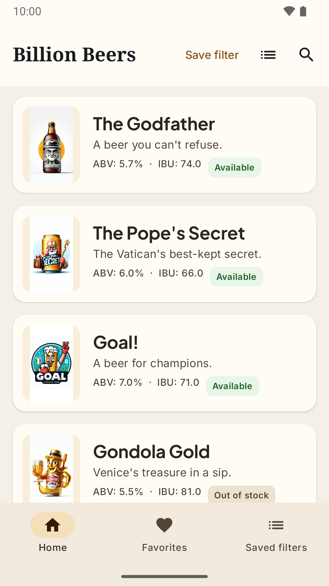
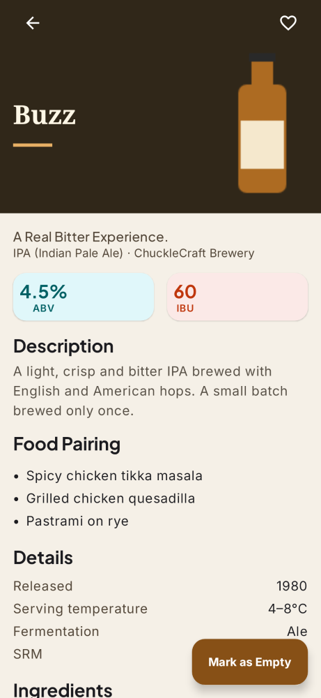
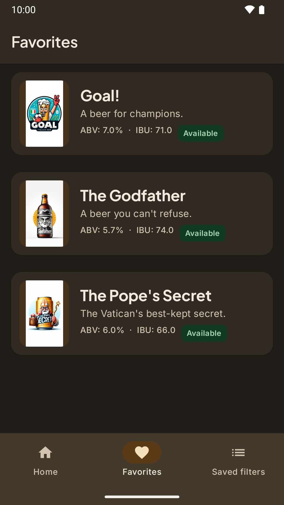
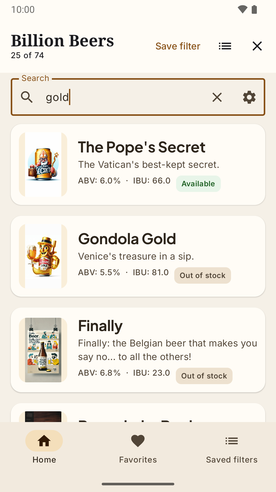
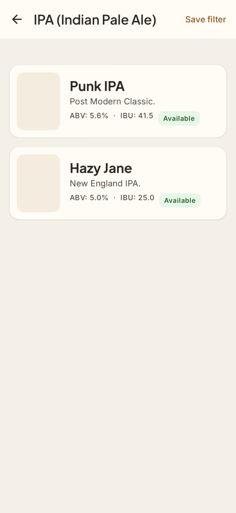
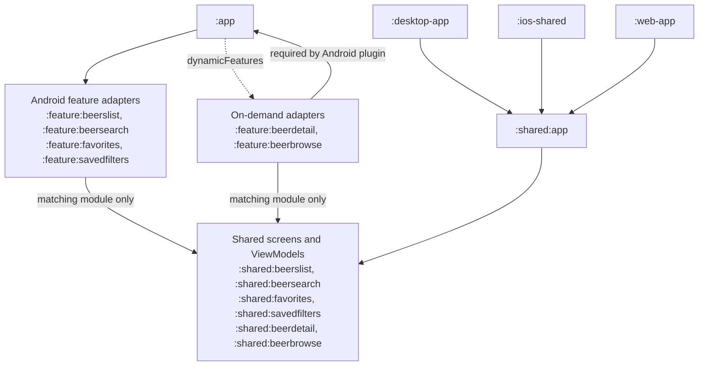
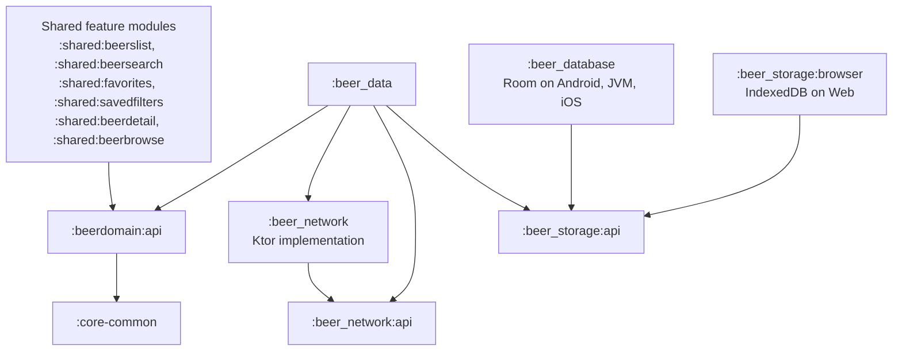

# BillionBeers

BillionBeers is a beer catalog built with Jetpack Compose, Metro DI, and Room. Browse by style
or brewery, search for beers, and save favorites and filters on your device. Availability flags
are local too. The app reads the remote catalog without changing it.

The project is also a reference for multi-module Android architecture. Konsist tests and Gradle
dependency checks enforce module boundaries. [ADRs](docs/adr/) explain the design choices.

[](https://play.google.com/store/apps/details?id=com.simtop.billionbeers)

[Run the app](#run-the-android-app) · [Architecture](#architecture) ·
[Checks](#development-checks) · [Platform support](#platform-support) · [ADRs](docs/adr/)

## App screenshots

Captured from the Android app running in an emulator, with loaded beer artwork.

<table>
  <tr>
    <th>Catalog</th>
    <th>Beer detail</th>
    <th>Favorites in dark theme</th>
  </tr>
  <tr>
    <td></td>
    <td></td>
    <td></td>
  </tr>
</table>

<details>
<summary>Search and browse screenshots</summary>

<table>
  <tr>
    <th>Search results</th>
    <th>Browse by style</th>
  </tr>
  <tr>
    <td></td>
    <td></td>
  </tr>
</table>

</details>

<!-- README images are unframed Android emulator captures.
Refresh them with android screen capture after navigating to each screen in the running app. -->

The Android app includes:

- A paged catalog, inline search, advanced filters, and browsing by style or brewery.
- Beer details with ABV, IBU, ingredients, and food pairings where available.
- Local favorites, saved filters, and availability flags, plus a Room-backed Favorites home-screen widget.
- Light and dark themes, with adaptive list-detail navigation for wider windows.
- On-demand delivery for the detail and browse features.

## Run the Android app

Use JDK 23 and Android SDK Platform 37. The app runs on Android 9 (API 28) or newer.
You also need Git LFS for screenshot baselines, Python 3, and Make. Point Gradle at the SDK
with `local.properties` or `ANDROID_HOME`.

1. Clone the repository and enter its directory.

   ```shell
   git clone https://github.com/simtop/BillionBeers.git
   cd BillionBeers
   ```

2. Install the local Git hooks and fetch LFS assets.

   ```shell
   make setup
   ```

3. Build the Android debug app.

   ```shell
   make build MODULE=:app
   ```

4. Start an emulator or connect a device with USB debugging enabled, then install the app.

   ```shell
   make install
   ```

`make install` uses bundletool local testing to stage the detail and browse features on the device.
The app installs each feature when you open it. Install `bundletool` first, or let the script install
it through Homebrew on macOS. The installer expects `ANDROID_HOME` or the default macOS SDK location.
If you clear the app's data, rerun `make install` to restore the staged features.

To work on the list screen with an in-memory repository, see the
[beers list dev app](app-dev-beerslist/README.md).

## Platform support

Android is the primary released target. Desktop, iOS, and Web hosts share domain, data, paging,
and Compose screen code through Kotlin Multiplatform. Their current scope is:

| Target | Current scope | Guide |
| --- | --- | --- |
| Android | Released app, on-demand features, and Favorites widget | [Android release evidence](docs/android_release_evidence.md) |
| Desktop | Local, unsigned macOS arm64 application and DMG | [Desktop host](docs/desktop_host.md) |
| iOS | Shared framework and unsigned simulator host | [iOS host](docs/ios_host.md) |
| Web | Wasm browser host, IndexedDB storage, and local static-output verification | [Web host](docs/web_host.md) |

The [KMP support matrix](docs/kmp_support_matrix.md) lists the checks and limitations for each host.

## Architecture

Features depend on domain contracts, which repositories implement in the data layer.
ViewModels have no dependency on network or storage types. Ktor and Kotlin Serialization handle
remote reads.
Room is the source of truth on Android, JVM, and iOS. Web uses IndexedDB behind the storage contract.

The diagrams show selected project dependencies. Solid arrows point from a module to a dependency.
Grouped boxes summarize several modules. For the full graph, use `make module-graph` and see the
[architecture reports guide](docs/architecture-reports.md).

### Hosts and shared screens

Each Android feature adapter depends on its matching shared feature module. Desktop, iOS, and Web
use `:shared:app` to compose the shared screens. Android keeps its navigation host in `:app` so
detail and browse can remain on-demand features.



The dashed arrow is delivery registration through `dynamicFeatures`. The reverse solid arrow is the
Gradle dependency that Android's dynamic-feature plugin requires. It does not mean feature source
code uses app classes. Cross-feature navigation on Android goes through `:navigation`, which exposes
`:navigation-contract`.

Android UI uses `:core:designsystem`, which exposes the shared tokens in `:shared:designsystem`.
Shared features use `:shared:designsystem` directly.

### Domain, network, and storage

Hosts assemble the data implementation with network and platform storage. Shared ViewModels depend
on domain contracts. Both Room and IndexedDB implement the storage contract used by `:beer_data`.



Shared feature modules do not depend on data implementations or sibling features. The
[architecture policy](config/architecture/project-dependency-policy.json) enforces the permitted
production dependencies, including each Android adapter's matching shared feature.

The main design choices are:

- ViewModels expose state through Kotlin Flow. Compose renders that state and sends user actions
  back to the ViewModel. One-shot events use `Channel(BUFFERED).receiveAsFlow()`.
- The repository coordinates remote reads and local storage. Hand-rolled paging keeps `PagingData`
  out of domain contracts. See [ADR 0002](docs/adr/0002-hand-rolled-paging.md).
- The data layer maps failures to typed sealed errors and returns them in `Either`.
- ViewModels call domain repository interfaces directly. Add a use case when it owns behavior
  beyond a repository call. See [ADR 0003](docs/adr/0003-use-case-policy.md).
- Android retains Play delivery, split installation, and Glance widget synchronization.
  See [ADR 0015](docs/adr/0015-room-backed-glance-widget-synchronization.md) and
  [ADR 0016](docs/adr/0016-incremental-kmp-targets-and-platform-adapters.md).

### Enforced boundaries

[Konsist tests](konsist/src/test/kotlin/com/simtop/konsist/) check source and build-script rules.
Gradle checks resolved dependencies to catch transitive violations as well.

| Boundary | Enforcement |
| --- | --- |
| Domain contracts have no Android or data-layer imports, and models are immutable | `DomainLayerPurityTest`, `RepositoryBoundaryTest`, `DomainModelImmutabilityTest` |
| Features do not depend on sibling features or data implementations | `FeatureModuleBoundaryTest`, `FeatureDataLayerBoundaryTest`, `checkDataLayerClasspathBoundary` |
| ViewModels depend on domain-layer types | `ViewModelBoundaryTest` |
| Dynamic features use shared user-facing resources | `DynamicFeatureResourceBoundaryTest` |
| ViewModels do not use `MutableSharedFlow` for one-shot events | `OneShotEventBoundaryTest` |
| Production project dependencies and intentional `api` exposures follow the role policy | `verifyArchitectureGraph` |

The suite also checks fixture placement, test-library scope, instrumented-test opt-in, and orphaned
source trees. [Convention plugins](build-logic/convention/src/main/kotlin/) centralize module setup.

Dependency verification, dependency-guard, and pinned GitHub Actions protect the build's inputs.
See [ADR 0006](docs/adr/0006-ci-supply-chain-hardening.md) and
[ADR 0007](docs/adr/0007-gradle-dependency-verification.md).
CI selects applicable test lanes from the changed paths under
[ADR 0008](docs/adr/0008-per-lane-ci-test-selection.md).

## Development checks

Run `make help` for the full command list. Scope supported commands with `MODULE=:module`.

| Task | Command |
| --- | --- |
| Build a feature | `make build MODULE=:feature:beerslist` |
| Run a module's tests | `make test MODULE=:feature:beerslist` |
| Run the full unit-test set, including build logic | `make test` |
| Check source architecture rules | `make konsist` |
| Check resolved project dependencies | `make architecture-policy` |
| Verify screenshot baselines and preview inventory | `make screenshot-verify` |
| Run app UI tests on the managed emulator | `make ui-test-managed MODULE=:app` |
| Run Detekt | `make lint` |
| Run Android Lint | `make android-lint` |
| Apply Spotless formatting | `make format` |
| Check Markdown links and the generated version table | `make docs-check` |

App UI tests default to the mock-backed Debug suite. Run minified `releaseSmoke` tests separately
because the selected variant changes the test sources and runner. See the
[Android release evidence](docs/android_release_evidence.md) for the commands and results.

For build-time measurements, use `make build-budget` on a quiet local machine and read
[ADR 0011](docs/adr/0011-build-time-budget.md). Startup performance checks require physical hardware.

## Stack versions

`make update-docs` generates this table from the version catalog and Gradle wrapper.
`make docs-check` verifies that the table matches those files.

<!-- START_VERSIONS -->
| Tech | Version |
| :--- | :--- |
| **Kotlin** | 2.4.21 |
| **Gradle** | 9.8.1 |
| **Compose BOM** | 2026.09.00 |
| **Metro DI** | 1.4.5 |
| **Room DB** | 2.8.5 |
<!-- END_VERSIONS -->

## Contributing

Start with the relevant [ADR](docs/adr/) and the existing feature's code. For changes that persist
local data across targets, use the [durable-feature change guide](docs/durable_feature_changes.md).
[ADR 0010](docs/adr/0010-non-goals.md) explains which capabilities are outside the project's scope.

Create a branch, keep the change focused, and run the checks that cover the affected behavior.
For UI changes, verify the screenshots and inspect any updated baselines. Open a pull request
with the behavior change and validation results. Never commit signing credentials or local configuration.

## Project history

Each link points to an exact commit, so the reference stays the same when branches move.
Dates show the month and year of each commit. Historical builds and API integrations may need
changes to run today.

### Useful checkpoints

| Checkpoint | Month and year | Source | What it shows |
| --- | --- | --- | --- |
| Metro DI on Android | April 2026 | [b843c764](https://github.com/simtop/BillionBeers/tree/b843c764c4d2f9c44ba054c95d8c8f779016ef0c) | The migration from Hilt to Metro DI. |
| Before agent tooling | June 2026 | [4df25d2e](https://github.com/simtop/BillionBeers/tree/4df25d2e182253a1cc45d7e21cb875a9d8a135bd) | The code before tracked agent instructions were added. |
| Last Android-only tree | September 2026 | [057e3db3](https://github.com/simtop/BillionBeers/tree/057e3db34dcdd88ee8434e1f0a5250753c6186b8) | The final Android-only code before KMP build tooling was added. |
| First KMP tooling | September 2026 | [316f6d61](https://github.com/simtop/BillionBeers/tree/316f6d61c1814c6d3a74744930a7aaa7171413b9) | An isolated KMP build fixture, before production code moved. |
| First production KMP module | September 2026 | [5b9ef10e](https://github.com/simtop/BillionBeers/tree/5b9ef10e47e37dbea306d134d97ec7a66038f163) | `core-common` production code moved to common sources. |
| First shared feature | September 2026 | [7c68d845](https://github.com/simtop/BillionBeers/tree/7c68d8459de286237f079e3cb92808f3ea82a6b9) | The favorites screen and ViewModel moved into shared code. |
| Web host added | September 2026 | [472b73fd](https://github.com/simtop/BillionBeers/tree/472b73fd51f6ffc4cc1576f8cce74d8bb73b215b) | The Web host and local image proxy, following the Desktop and iOS shells. |

### Earlier experiments

<details>
<summary>Android architecture snapshots, October 2020 to March 2026</summary>

These commits preserve earlier experiments. Each date identifies the selected snapshot,
which may be later than the first implementation.

| Month and year | Experiment |
| --- | --- |
| October 2020 | [Paging 3 with Room](https://github.com/simtop/BillionBeers/tree/9e8bdbf96a4856de0bcb81637677e17af80b9f05) |
| October 2020 | [Paging 3 with network](https://github.com/simtop/BillionBeers/tree/5d4bfeca904fa4ba89ad022109b4dc83821dab97) |
| October 2020 | [StateFlow](https://github.com/simtop/BillionBeers/tree/81e95ff9fa2dcca12fda022ce77f4cee4a681087) |
| December 2020 | [Dagger monolith](https://github.com/simtop/BillionBeers/tree/28e210a139449ac02de27594e4d06a75c0900f53) |
| January 2021 | [Hilt monolith](https://github.com/simtop/BillionBeers/tree/9fc6733f3f3a7f520211acaf175c644c78b60d2a) |
| March 2021 | [Initial Hilt modules](https://github.com/simtop/BillionBeers/tree/462f33454fd73be832913c857abd94370581655a) |
| March 2021 | [Assisted injection](https://github.com/simtop/BillionBeers/tree/a8fcef2859c5d2ed34fb24b95c4d931a0b648c4e) |
| April 2021 | [Layered Hilt modules](https://github.com/simtop/BillionBeers/tree/14ab86a8b7cc8e7eedf7b0b4fe0199d5bc21c317) |
| May 2021 | [R8 rules](https://github.com/simtop/BillionBeers/tree/06eccb06549706951e26a215b09e828e9989d030) |
| May 2021 | [Dynamic features](https://github.com/simtop/BillionBeers/tree/2d21d85223715384517e2aa8e5861dc08590b1b4) |
| May 2021 | [On-demand features](https://github.com/simtop/BillionBeers/tree/f9a32730e62b98700e406c3f396ee1d32051d133) |
| June 2021 | [SonarQube and JaCoCo](https://github.com/simtop/BillionBeers/tree/162a238fce3b7203974fa3d2b2839bd57876c402) |
| November 2021 | [SonarQube](https://github.com/simtop/BillionBeers/tree/aacfab6e2077f71d18884749103f73b077de6912) |
| January 2022 | [Version catalog](https://github.com/simtop/BillionBeers/tree/96dc415711944f7595805ede75fc0d58bbf50c61) |
| July 2022 | [Compose migration](https://github.com/simtop/BillionBeers/tree/3ead5f36b8dce137bdcb1726ca86ee478167416b) |
| May 2025 | [Kotlin build scripts](https://github.com/simtop/BillionBeers/tree/bbe38b5de11b904593b1e1b0da823f6411fd0901) |
| May 2025 | [KSP processing](https://github.com/simtop/BillionBeers/tree/88e7e69c93b732a53a0aa59bef16e79664f5aea6) |
| November 2025 | [Precompiled conventions](https://github.com/simtop/BillionBeers/tree/a9536e6d9597ffa51cca3936b4534b0d3f28aedf) |
| December 2025 | [Compose navigation](https://github.com/simtop/BillionBeers/tree/1a04a1c8769bdceaaf1c95968909d223933312bd) |
| December 2025 | [Dependency auditing](https://github.com/simtop/BillionBeers/tree/9fd6cb65c00f66626372b50fb9446b88c68d51b3) |
| January 2026 | [Baseline profiles](https://github.com/simtop/BillionBeers/tree/ed68a42102f34d5c6d3eb99a7927b42baf8f9745) |
| March 2026 | [Component catalog](https://github.com/simtop/BillionBeers/tree/f9bc5cb09a85ad37837c78ded3207d9e2e75c6f2) |

The version-catalog reference uses the `feature/version_catalog2` snapshot.

</details>

## License

[MIT](LICENSE). Built by Simon Topchyan.
